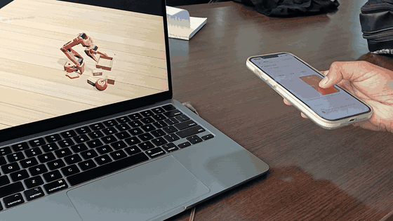
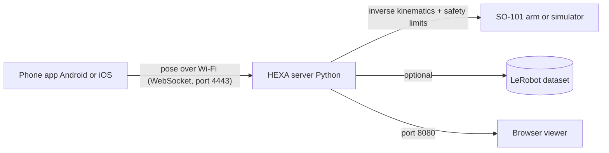
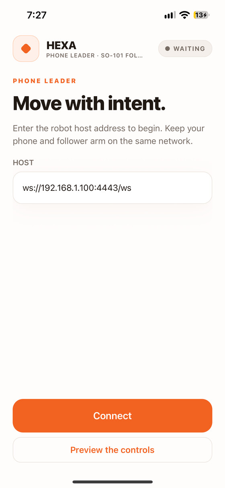
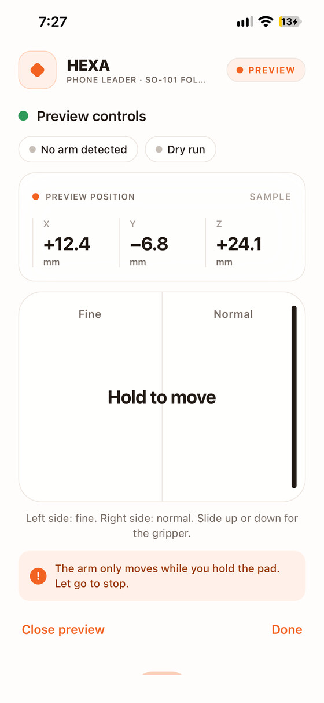
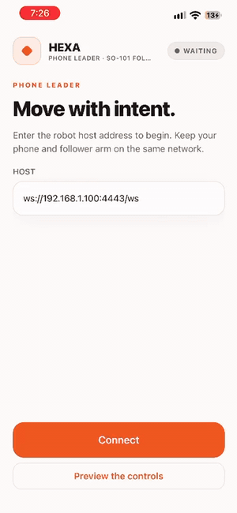
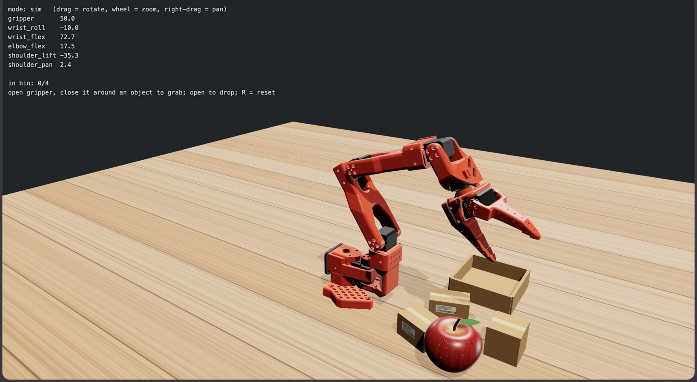

<div align="center">

# HEXA

### Your phone is the leader arm.

Hold your phone, move it through the air, and a real (or simulated) **SO-101 robot arm** follows.
Every move can be recorded as a **LeRobot dataset** for training robot policies.

**Built for research.** We use this arm in our research paper, and HEXA is how we drive it and collect our data.

[Why](#why-we-built-this) · [How it works](#how-it-works) · [Quick start](#quick-start) · [Record data](#record-demonstrations) · [Real arm](#using-the-real-arm) · [Research](#built-for-research)


<br>



<sub>An iPhone driving the simulated arm. No leader arm, just the phone. <a href="docs/media/hexa-sim-demo.mp4">Watch the full 30-second clip</a>.</sub>

<br>

| 📱 **No leader arm** | 🤖 **Android + iPhone** | 🧪 **Simulator first** | 📦 **LeRobot-ready data** |
| :---: | :---: | :---: | :---: |
| Your phone is the controller | ARCore and ARKit, one server | Learn the controls safely | State, action, video, task |

</div>

---

## Why we built this

Teaching a robot by demonstration (imitation learning, and the new wave of vision-language-action models) needs one thing above all: **lots of good human demonstrations**.

The usual way to collect them is a **leader arm**: a second robot arm that a human moves while the follower copies. It works well, but it means extra hardware, extra wiring, and one more thing a student, a club or a small lab has to afford before they can even start collecting data.

Meanwhile, everyone already carries a device with a world-class 6-DoF tracker, a gyroscope and Wi-Fi: **a phone**.

So HEXA turns that phone into the leader arm.

- **No second arm.** Just the follower arm and the phone you already own.
- **Android and iPhone.** ARCore on Android, ARKit on iOS, same server and same protocol.
- **Safe to try first.** A built-in simulator and a browser viewer, so you can learn the controls before the real arm moves.
- **Straight into training.** Recordings are written as LeRobot datasets (state, action, camera video, task), ready for policy training.

> The goal is simple: make collecting robot demonstration data something anyone with a phone and an SO-101 can do.

---

## Built for research

We are using the SO-101 arm in our research, and HEXA is the tool we built to operate it and gather demonstration data. We needed a way to teleoperate the arm quickly, with hardware we already had, and to record clean, consistent episodes in a format the LeRobot tooling understands.

HEXA is that tool, and we are sharing it so other students and labs can do the same.

**Paper and citation: coming soon.**

---

## How it works



1. The phone tracks its own position and rotation (ARCore on Android, ARKit on iOS).
2. It streams that pose to the server over your local Wi-Fi.
3. The server converts the phone's motion into joint angles for the SO-101 using its URDF, with smoothing, speed limits and joint limits.
4. The arm moves, the viewer shows it, and the recorder (if on) logs the episode.

---

## The app

<p align="center">
  
  &nbsp;
  
  &nbsp;
  
</p>

<p align="center"><sub>Connect to the server, then hold the pad to move: Fine on the left, Normal on the right, slide for the gripper. (iPhone, preview mode.)</sub></p>

### The simulator

<p align="center">
  
</p>

<p align="center"><sub>The browser viewer at <code>localhost:8080</code>: live joint angles, plus a pick-and-place scene (open the gripper, close it around an object to grab, open to drop, <code>R</code> to reset). Drag to rotate, scroll to zoom, right-drag to pan.</sub></p>

---

## What's in the download

This repo holds **`HEXA-Team.zip`**. Unzip it and you get a folder called `EmberArm-Team` (the project's working name):

| Inside the zip | What it is |
| --- | --- |
| `EmberArm-Final.apk` | Ready-to-install **Android** app |
| `PhoneTeleop.ipa` | Ready-to-sideload **iOS** app (shows up as **HEXA** on the phone) |
| `server/` | The Python host that runs on your computer: kinematics, safety, robot control, recorder, browser viewer. Start it with `emberarm.sh` (macOS, Linux) or `emberarm.bat` (Windows) |
| `app-source/` | The phone app source (React Native, with native ARCore and ARKit modules) |
| `FRIEND-SETUP.md` | One-page Windows quick start |
| `README.md` | The zip's own short guide |

The `docs/media/` folder in this repo only holds the screenshots, GIFs and videos shown on this page.

---

## Quick start

Start with the **simulator**. No arm needed, nothing can go wrong.

You need:

- A computer (macOS, Ubuntu 22.04, or Windows 11) with **Python 3.10+**
- An **Android phone with ARCore** or an **iPhone with ARKit**
- The phone and the computer on the **same Wi-Fi**

### 0. Download the project

Click **`HEXA-Team.zip`** at the top of this page, then the download icon (**Download raw file**), and unzip it. Or from a terminal:

```bash
curl -L -o HEXA-Team.zip https://github.com/Deepakk-06/hexaa/raw/main/HEXA-Team.zip
unzip -q HEXA-Team.zip
```

You now have the `EmberArm-Team` folder.

### 1. Install the phone app

<table>
<tr>
<td width="50%" valign="top">

#### Android

1. Copy `EmberArm-Final.apk` to the phone.
2. Tap it to install. If asked, allow **Install unknown apps** for the app you opened it from.
3. If Play Protect warns you, tap **Install anyway** (the app isn't from the Play Store).
4. Open the app and allow **Camera**.
5. If it asks for **Google Play Services for AR**, install or update it.

</td>
<td width="50%" valign="top">

#### iPhone

1. Install [Sideloadly](https://sideloadly.io) on a Mac or Windows PC. On Windows, install iTunes and iCloud from apple.com, **not** the Microsoft Store.
2. Plug in the iPhone, drag `PhoneTeleop.ipa` into Sideloadly, enter your Apple ID and click **Start**.
3. On the phone: **Settings → General → VPN & Device Management** → trust your Apple ID.
4. On iOS 16+, turn on **Settings → Privacy & Security → Developer Mode** if asked, then restart.
5. Open **HEXA** and allow **Camera**.

Free Apple IDs expire the app after **7 days**. Just sideload again.

</td>
</tr>
</table>

### 2. Start the server

**macOS or Ubuntu**

```bash
cd EmberArm-Team/server
chmod +x emberarm.sh
./emberarm.sh setup --no-lerobot
./emberarm.sh start --sim
```

On Ubuntu, first run `sudo apt install -y python3 python3-venv python3-pip`. If you use a VM, set its network to **Bridged**.

**Windows (WSL2, recommended)**

In PowerShell **as Administrator**:

```powershell
wsl --install -d Ubuntu
```

Restart, then:

```powershell
Set-Content "$env:USERPROFILE\.wslconfig" "[wsl2]`nnetworkingMode=mirrored"; wsl --shutdown
New-NetFirewallRule -DisplayName HEXA -Direction Inbound -Protocol TCP -LocalPort 4443,8080 -Action Allow
Set-NetFirewallHyperVVMSetting -Name '{40E0AC32-46A5-438A-A0B2-2B479E8F2E90}' -DefaultInboundAction Allow
```

Put `HEXA-Team.zip` in your Windows **Downloads** folder, open **Ubuntu** from the Start menu, and run:

```bash
sudo apt update && sudo apt install -y unzip python3-venv python3-pip && unzip -oq "$(ls /mnt/c/Users/*/Downloads/HEXA-Team.zip | head -1)" -d ~ && cd ~/EmberArm-Team/server && chmod +x emberarm.sh && ./emberarm.sh setup && ./emberarm.sh start --sim
```

(There is also a native `emberarm.bat` for Windows: `emberarm.bat setup --no-lerobot`, then `emberarm.bat start --sim`.)

When it starts, the server prints:

```
In the phone app enter:  ws://192.168.x.x:4443/ws
```

Copy that address. Your numbers will differ.

### 3. Connect and move

1. Open the app, type the address, tap **Connect**. The server says `Phone connected.`
2. Tap **Start tracking**. Move the phone slowly with its **back camera facing a bright, patterned surface** until it says **Ready**.
3. Stand behind the robot, point the phone's back camera toward the front of the robot, and tap **Calibrate**.
4. **Hold your thumb on the pad to move.**

| Control | What it does |
| --- | --- |
| Hold the pad | Arm follows the phone |
| Left half of pad | Slow and precise |
| Right half of pad | Normal speed |
| Slide thumb up or down while holding | Open or close the gripper |
| Let go | Arm stops. Each new press starts from where the arm is, so it never jumps |

Open **http://localhost:8080** on the computer to watch the simulated arm in your browser. Tap **Preview the controls** on the app's first screen to explore without a server.

---

## Record demonstrations

```bash
./emberarm.sh record --sim --max-speed 150
```

Add `--task "pick up the cube"` to label the episodes. Data goes to `server/datasets/emberarm_demo` by default (`--dataset-dir` changes it).

- With LeRobot installed, you get a real **LeRobotDataset**: `observation.state`, `action`, camera video and the task, at 30 fps.
- Without it, episodes fall back to plain **NPZ** files so nothing is lost, and you can convert later.

---

## Using the real arm

> **The real arm moves for real.** Keep a hand near the power supply, move slowly, and support the arm before stopping the server. When the server stops, the motors turn off and the arm goes limp.

```bash
./emberarm.sh setup        # installs LeRobot (large, needs internet)
./emberarm.sh calibrate    # move each joint through its full range, once
./emberarm.sh start        # dry run: prints what it would do, nothing moves
./emberarm.sh start --live # moves the real arm
```

| Flag | When to use it |
| --- | --- |
| `--arm-port /dev/ttyACM0` (or `COM3`) | More than one USB device plugged in |
| `--id YOUR_NAME` | You named the arm differently when calibrating |
| `--roll-sign -1` | The wrist twists the wrong way |
| `--invert-gripper` | The gripper opens when it should close |
| `--max-speed N` | Joint speed cap in degrees per second |

On Ubuntu, if the USB port says "permission denied": `sudo usermod -aG dialout $USER`, then log out and back in.

---

## Safety

- The arm only moves while you **hold the pad and tracking says Ready**.
- Letting go, losing Wi-Fi for 3 seconds, or closing the app stops new commands.
- Speed is capped and joints are kept inside their allowed range.
- This is a lab tool, not a certified safety system. Stay close, go slow.

---

## Platform support

| | Tracking | Status |
| --- | --- | --- |
| **Android** | ARCore + phone motion sensors (hybrid) | Works. Tested on Samsung Galaxy A35 |
| **iPhone** | ARKit world tracking | Works (sideloaded with Sideloadly) |
| **Server on macOS** | | Built and tested here |
| **Server on Ubuntu / Windows (WSL2)** | | Same Python code. Should work. Please report issues |

---

## Troubleshooting

| Problem | Try this |
| --- | --- |
| App can't connect | Server window must stay open. Phone and computer on the **same Wi-Fi**. Type the address exactly as printed. Office and guest Wi-Fi often block device-to-device traffic, so use a home router or a phone hotspot. On Windows, allow ports 4443 and 8080 through the firewall |
| Address changed | It can change when Wi-Fi reconnects. Restart the server and copy the new address |
| Stuck on "Initializing" or "Tracking lost" | Face the back camera at a bright, patterned surface and move slowly. Blank walls and dark rooms don't work |
| Movement is shaky | Hold the phone with both hands and move steadily. Compare without smoothing: `EMBERARM_SMOOTH=0 ./emberarm.sh start --sim` |
| Arm goes the wrong way | Tap **Calibrate** again after tracking was lost |
| "Phone went silent" | The phone stopped sending for 3 seconds (screen locked, app backgrounded, Wi-Fi dropped). Keep the screen on and reconnect |
| `MISSING lerobot` or `MISSING opencv` | Normal in simulation. Only the real arm needs LeRobot |
| iPhone app stopped opening | The free-account signing expired after 7 days. Sideload again |

Check the server's math with no phone or arm: `./emberarm.sh selftest` (should end with `URDF OK`).

---

## Rebuilding the apps

Only needed if you change the code in `app-source/`. You need Node.js 22+.

**Android** (JDK 17 and the Android SDK):

```bash
cd EmberArm-Team/app-source
./build-apk.sh
```

**iOS** (a Mac with Xcode):

```bash
cd EmberArm-Team/app-source
npm install
cd ios && pod install
```

Then open `PhoneTeleop.xcworkspace` in Xcode. (`PhoneTeleop` is the app's internal project name.)

---

## Tested devices

HEXA has been tested and works on both platforms:

| Platform | Device | Status |
|:---|:---|:---:|
| iOS (ARKit) | iPhone 13 | ✅ Works |
| Android (ARCore) | Samsung Galaxy A35 | ✅ Works |

Other phones with ARKit or ARCore support should work too. If you try one, let us know.

### Hardware and software

| Mode | Setup | Status |
|:---|:---|:---:|
| Hardware | Real SO-101 robot arm (`start --live`) | ✅ Works |
| Software | Simulator + browser viewer (`start --sim`) | ✅ Works |

---

## Acknowledgments

HEXA stands on great open-source work. Thank you to:

- **[SO-101 / SO-ARM100](https://github.com/TheRobotStudio/SO-ARM100)** by TheRobotStudio and Hugging Face, for the robot arm design, CAD parts and URDF used here
- **[LeRobot](https://github.com/huggingface/lerobot)** by Hugging Face, for robot control, calibration and the dataset format
- **[onshape-to-robot](https://github.com/Rhoban/onshape-to-robot)**, which generated the arm's URDF
- **Google ARCore** and **Apple ARKit**, for phone motion tracking
- **[React Native](https://reactnative.dev)** by Meta, for the phone app
- **[three.js](https://threejs.org)**, for the browser viewer
- **websockets**, **NumPy** and **pySerial**, for the Python server

---

## License

HEXA's own code is released under the [MIT License](LICENSE). The SO-101 robot design files and other third-party libraries keep their original licenses.

---

## Tech

React Native 0.88 · Kotlin + ARCore · Swift + ARKit · Python (`websockets`, `numpy`, `pyserial`) · LeRobot · SO-101 URDF

---

<div align="center">

**Built by Deepak 🚀 · A M Likhitha · Chiranthan P**

If HEXA helps you collect data or learn robotics, a ⭐ is appreciated.

</div>

<p align="center"><sub>Built by our team for research purposes. A work in progress.</sub></p>
